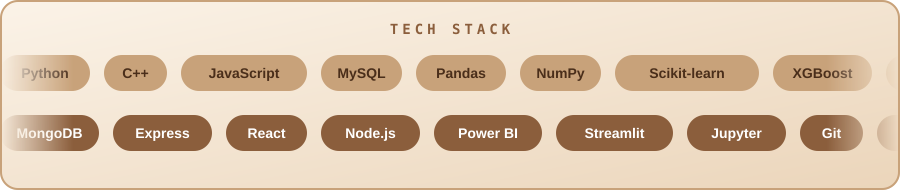
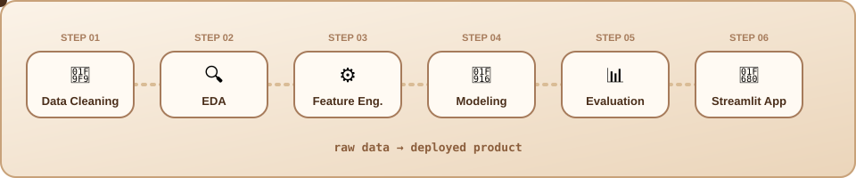

  

  
  
  
  

B.Tech IT &nbsp;·&nbsp; ADGIPS, Delhi &nbsp;·&nbsp; GGSIPU &nbsp;·&nbsp; Batch 2024-2028

<h2 align="center">About</h2>

<h2 align="center">Stack</h2>

<h2 align="center">Workflow</h2>

<h2 align="center">Featured Projects</h2>

<!-- Jin projects ka exact repo naam nahi pata, unke link repositories tab par hain. Exact repo URL se replace kar do. -->
<table align="center">
  <tr>
    <td align="center" width="50%" valign="top">
      <h3>💳 <a href="https://github.com/mkumar2177?tab=repositories">PayGuard AI</a></h3>
      Merchant-facing payment intelligence platform: XGBoost models, AI agents with tool-calling, 16-page Streamlit dashboard, Razorpay sandbox.  
        
    </td>
    <td align="center" width="50%" valign="top">
      <h3>🗺️ <a href="https://github.com/mkumar2177?tab=repositories">BhuSetu</a></h3>
      Land acquisition delay-risk model for decision support: XGBoost with SHAP explainability, district risk map and what-if simulation.  
        
    </td>
  </tr>
  <tr>
    <td align="center" width="50%" valign="top">
      <h3>🧩 <a href="https://github.com/mkumar2177?tab=repositories">Umar CodeSheet</a></h3>
      DSA practice and contest tracking platform with JWT auth, MongoDB Atlas and 366 seeded questions across 15 topics.  
         
    </td>
    <td align="center" width="50%" valign="top">
      <h3>🏙️ <a href="https://github.com/mkumar2177/-Demo-smart-city-analytics-suite">Smart City Analytics Suite</a></h3>
      Team project: analytics and dashboards for smart-city data.  
        
    </td>
  </tr>
  <tr>
    <td align="center" width="50%" valign="top">
      <h3>🕵️ <a href="https://github.com/mkumar2177/Credit-Card-Fraud-Prediction-ANN-">Credit Card Fraud Prediction</a></h3>
      ANN-based classifier to detect fraudulent transactions.  
       
    </td>
    <td align="center" width="50%" valign="top">
      <h3>🚗 <a href="https://github.com/mkumar2177/Car-Prize-Prediction-Using-Random_Forest_Regression">Car Price Prediction</a></h3>
      Random Forest regression model to predict used-car prices.  
       
    </td>
  </tr>
</table>

  
   
  Smart Traffic Management · Breast Cancer KNN · Heart Disease Decision Tree · House Price Decision Tree

<h2 align="center">GitHub Analytics</h2>

  
  

  

<h2 align="center">Let's Connect</h2>

Open to <b>internships, collaborations and freelance work</b> in data science, ML and full-stack development.

  
  

